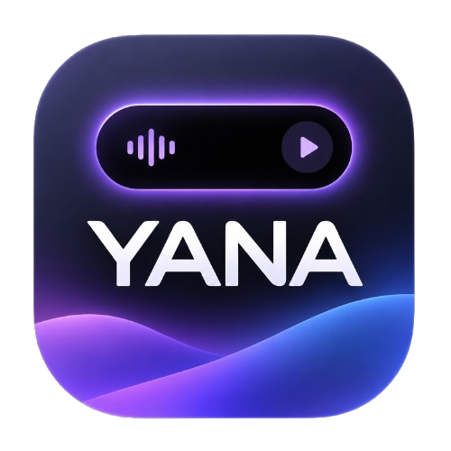

<p align="center">
  
</p>

<h1 align="center">YANA — Yet Another Notch App</h1>

<p align="center">
  A free, open-source app that turns the MacBook notch into a "Dynamic Island":<br>
  live activities, media controls, HUDs, notifications, messages, calls, calendar, weather, timers and a file shelf.
</p>

<p align="center">
  <a href="../../releases/latest"><b>⬇️ Download the latest release</b></a>
</p>

---

## Features

| Module | What it does |
|---|---|
| **Live activity** | Album art + equalizer, or a timer countdown, on the sides of the notch |
| **Now Playing** | Spotify and Apple Music: artwork, seek bar, shuffle, play/pause, next/previous |
| **Universal control** | Media keys for any other app (browsers, YouTube, VLC, Podcasts…) |
| **Audio** | System volume, mute, output switching (AirPods, HDMI…), per-app volume for Spotify/Music |
| **HUD** | Replaces the macOS volume and brightness overlay; shows charging and low battery (20% / 10%) |
| **Notifications** | Notifications from every app (WhatsApp, Telegram, Mail…) inside the notch |
| **Messages** | SMS/iMessage preview, conversations and quick reply |
| **Phone** | iPhone recent calls, missed-call alerts, keypad, calls via iPhone (Continuity) or FaceTime audio |
| **Calendar** | Upcoming events, reminder 10 minutes before, one-click "Join" for Zoom / Meet / Teams / Webex |
| **Weather** | Current conditions + hourly forecast (Open-Meteo, no API key) |
| **Timer** | Pomodoro, break and custom timers with a live countdown in the notch |
| **Shelf** | Drop files on the notch, drag them out later, AirDrop them |
| **System** | CPU / RAM / battery rings, brightness, lock screen, display off, dark mode toggle, screenshot |
| **Gestures** | Swipe down on the notch to open, swipe up to close, swipe sideways to switch tab or track |
| **Appearance** | Optional frosted glass, ambient glow taken from the album art, tinted controls |

Available in **English** and **Italian** (follows the system language).

## Requirements

- macOS 14 Sonoma or later
- A Mac with Apple Silicon. YANA is designed for MacBooks with a notch; on other displays it shows a virtual notch in the middle of the menu bar.

## Install

1. Download **`YANA-x.y.z.dmg`** (or the `.zip`) from the [latest release](../../releases/latest).
2. Open the DMG and drag **YANA** to **Applications**.
3. Open YANA from Applications.

### First launch: "YANA can't be opened"

YANA is free and isn't notarized by Apple (that needs a paid developer account), so macOS blocks it the first time. Pick one of these options:

- **System Settings:** try to open YANA once, then go to **System Settings › Privacy & Security**, scroll down and click **Open Anyway**.
- **Terminal:**
  ```bash
  xattr -dr com.apple.quarantine /Applications/YANA.app
  open /Applications/YANA.app
  ```

YANA has no Dock icon. Look for the **capsule icon** in the menu bar: it has Settings, Permissions, Preferences, Launch at login and Quit.

## Permissions

YANA only asks for what each feature needs. You can see and grant everything in **YANA › Settings… › Permissions**.

| Permission | Used for | Without it |
|---|---|---|
| **Accessibility** | Replacing the volume/brightness HUD, media keys, lock screen | The system HUD stays and the universal media control doesn't work |
| **Full Disk Access** | Reading SMS/iMessage, iPhone call history and app notifications | The Messages, Phone and Notifications tabs stay empty |
| **Calendar** | Upcoming events and meeting links | No events |
| **Contacts** | Showing names instead of numbers | Numbers and emails are shown |
| **Location** | Local weather | No weather |
| **Automation** | Controlling Spotify, Music and Messages (asked on first use) | No track info, no SMS replies |

> Accessibility and Full Disk Access must be added by hand in **System Settings › Privacy & Security**. Use the **+** button, pick `/Applications/YANA.app`, then quit and reopen YANA.

**Privacy:** every database is opened read-only and nothing leaves your Mac. The only network requests are the weather (Open-Meteo, with coordinates rounded to about 100 m) and Spotify album art. There is no analytics and no telemetry.

## Usage

- **Open:** hover the notch, swipe down on it, or drag a file onto it. You can switch to click-to-open in Settings.
- **Close:** move the pointer away, click outside, or swipe up on the top bar.
- **Switch tabs:** click the icons on the left of the top bar, or swipe left/right on it.
- **Skip tracks:** with music playing and the notch closed, swipe left/right on the notch.
- **Volume / brightness keys:** the HUD appears in the notch. Hold **⌥⇧** for fine steps.
- **Settings:** the capsule icon in the menu bar › **Settings…** (⌘,). It has a live preview of the notch.

## Build from source

You only need the **Command Line Tools**, not Xcode:

```bash
xcode-select --install          # if you don't have them yet
git clone https://github.com/veaceslavmafteiaevoluta/yana.git
cd yana
./build.sh                      # creates build/YANA.app
cp -R build/YANA.app /Applications/
open /Applications/YANA.app
```

Other useful commands:

```bash
swift build                              # debug build only
build/YANA.app/Contents/MacOS/YANA       # run from Terminal and see the logs
build/YANA.app/Contents/MacOS/YANA -AppleLanguages "(en)"   # force a language
pkill -x YANA                            # quit the running instance
defaults delete com.yana.app             # reset preferences
```

### Keep permissions across rebuilds

`./build.sh` signs ad-hoc by default, so the code identity changes on every build and macOS forgets the Accessibility and Full Disk Access grants. To avoid this, create a personal code-signing certificate once:

1. Open **Keychain Access › Certificate Assistant › Create a Certificate…**
2. Name: `YANA Local Signing`, Identity Type: *Self-Signed Root*, Certificate Type: *Code Signing*.
3. Run `tccutil reset All com.yana.app`, then `./build.sh`. The script finds the certificate on its own. To use a different certificate, run `SIGN_ID="Name" ./build.sh`.

### Making a release

```bash
./scripts/release.sh            # builds dist/YANA-<version>.dmg and .zip
./scripts/release.sh --publish  # also creates the GitHub release (needs the gh CLI)
```

The version comes from `CFBundleShortVersionString` in `Resources/Info.plist`.

### Project layout

```
Sources/YANA/App        entry point, AppDelegate, menu bar item
Sources/YANA/Core       notch window, notch shape, state machine (closed / peek / open)
Sources/YANA/Services   one singleton per area: media, audio, messages, calls, weather…
Sources/YANA/Views      SwiftUI tabs, HUD and Settings window
Resources               Info.plist, app icon, translations (en, it)
scripts                 icon generation and release packaging
```

> **Note for contributors:** SwiftUI macros (`@State`, `@Observable`, `#Preview`) don't compile without Xcode. Use `Box<T>` with `@StateObject` instead (see `Views/Components.swift`). Every user-facing string goes through `L("English text")` and has an entry in `Resources/it.lproj/Localizable.strings`.

## Known limitations (macOS)

- There's no API to draw *inside* the notch. YANA, like every app of this kind, uses a black window shaped like the notch above the menu bar.
- Incoming iPhone calls can't be answered from the notch. YANA shows the alert and missed calls instead.
- Since macOS 15.4 the system "Now Playing" API is closed to third-party apps. You get full track info for Spotify and Music, and media-key control for everything else.
- Keyboard backlight keys and lock-screen widgets aren't reachable with public APIs.
- The equalizer and the glow pulse are animations; they don't analyze the actual audio.

## License

[MIT](LICENSE)
